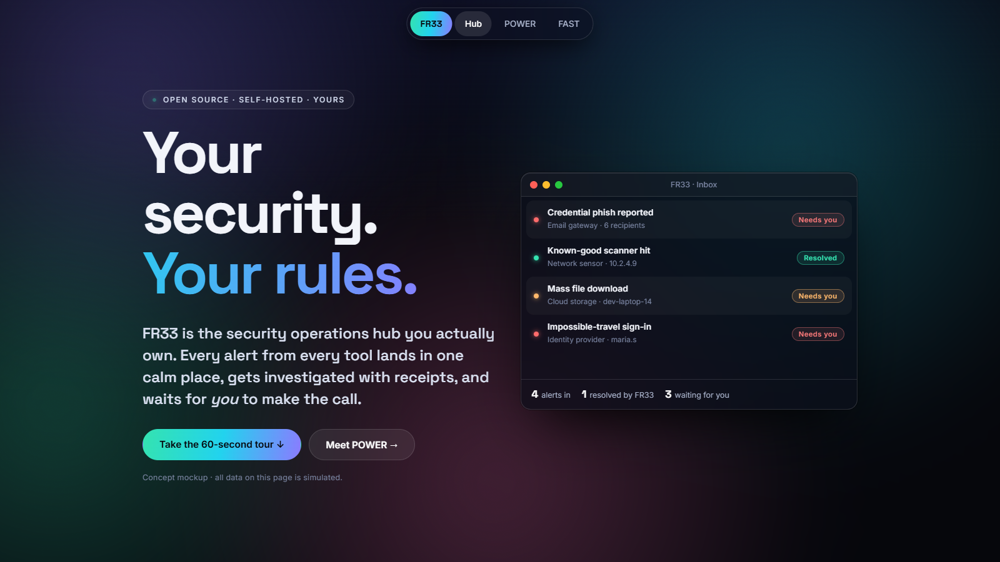
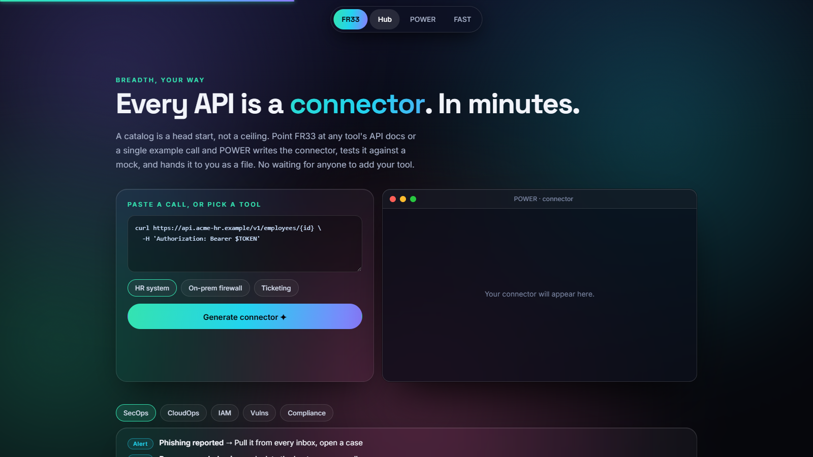

# FR33

**The security operations hub you own. Open source, self-hosted, and it waits for you to make the call.**

Every alert from every tool lands in one calm place, gets investigated with receipts, and waits for a person to decide.
This is the interactive walkthrough: a live inbox, a 60-second tour with the approve switch, "every API is a connector",
agents with an autonomy dial, a tamper test on the audit chain, and a case queue with live clocks.
Everything on the page is simulated: no real data, no network calls, no install, no build step.

**Live demo:** https://tootenramen.github.io/FR33/

## The family

| Project | What it is |
|---|---|
| [FR33](https://github.com/Tootenramen/FR33) | the hub: alerts, cases, agents, audit |
| [POWER](https://github.com/Tootenramen/POWER) | describe an automation in plain words; it builds, tests and shows you the diff |
| [FAST](https://github.com/Tootenramen/FAST) | the always-there mentor: it asks small questions until it can write the spec for you |

## What's inside

| Path | What it is |
|---|---|
| `index.html` | the walkthrough page |
| `shared.css`, `shared.js` | the look (aurora glass) and the small dependency-free script behind it |
| `docs/BIBLE.md` | the checklist: every claim on the pages, whether it is real yet, and the build log |
| `docs/` | screenshots used in this README |

## Use it

1. Visit the live demo, or open `index.html` in any browser.
2. Try the tour, flip the approve switch, run the tamper test, change the autonomy dial.

This is a concept page and a design target. The checklist in `docs/BIBLE.md` says honestly which claims are built and
which are not.

---
Built by [Gustavo Freitas](https://github.com/Tootenramen) - [LinkedIn](https://www.linkedin.com/in/gustavo-freitas-69b93910b/) - [more projects](https://github.com/Tootenramen)
